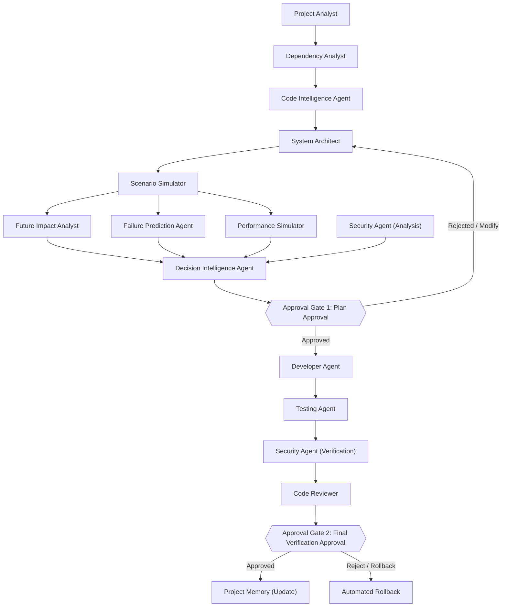

# RealityForge AI: Agent Contracts & Orchestration Specification

This document defines the formal Input/Output contracts, handoff protocols, approval gates, and conflict resolution rules across all RealityForge AI agents.

---

## 1. Supported Execution Models in Antigravity

RealityForge AI operates on three supported execution models in Google Antigravity:

| Model | Mechanism | Best Used For | Autonomy Level |
| :--- | :--- | :--- | :--- |
| **Model A: In-Session Sequential Role Execution** *(Default)* | Antigravity Agent loads specialized agent cards via `read_file` and executes them step-by-step within the active turn. | Interactive sessions, real-time feedback, environments without separate agent processes. | Human-Guided / Supervised |
| **Model B: Workflow Script Orchestration** | Python script run via Antigravity's `run_workflow` tool utilizing `pipeline`, `parallel`, and `phase` primitives. | Batch analysis, parallel multi-module scans, aggregated review pipelines. | Semi-Autonomous Orchestration |
| **Model C: Task-Specific Subagent Delegation** | Antigravity `invoke_subagent` launching dedicated agents (`research`, `self`, `browser`). | Deep codebase surveys, isolated sandboxed tasks, UI validation. | Delegated Autonomous Execution |

> [!CAUTION]
> **Unsupported Execution Claims (Deprecated):**
> Commands such as `agy run-workflow ... --mode A`, `agy test realityforge_ai`, or right-clicking markdown files to invoke workflows are **not** native Antigravity CLI features. Do not attempt to run or document fictitious CLI syntax.

---

## 2. Agent Input / Output Contracts & Handoff Rules

### 2.1 Discovery & Analysis Phase

#### 1. Project Analyst
* **Role:** Repository structure mapping and tech stack identification.
* **Input Contract:** Workspace root path, repository file tree.
* **Output Contract:** Markdown `Project Overview` containing Stack Summary, Directory Map, Core Services, and Entry Points.
* **Handoff Target:** `Dependency Analyst`
* **Preconditions:** Workspace must be accessible with read permissions.
* **Postconditions:** At least one programming language and primary entry point must be identified.

#### 2. Dependency Analyst
* **Role:** Package manifest parsing and dependency graph mapping.
* **Input Contract:** Package manifests (`package.json`, `requirements.txt`, `pom.xml`, `go.mod`, etc.).
* **Output Contract:** `Dependency Graph` report detailing direct and transitive dependencies, version constraints, and mismatched/unused libraries.
* **Handoff Target:** `Code Intelligence Agent`
* **Preconditions:** Project Analyst overview completed.
* **Postconditions:** All declared dependencies must be categorized.

#### 3. Code Intelligence Agent
* **Role:** Static analysis, syntax verification, type checking, and complexity mapping.
* **Input Contract:** Source code files identified by Project Analyst.
* **Output Contract:** `Code Intelligence Report` containing type-check outputs, cyclomatic complexity hotspots, dead code detections, and API surface.
* **Handoff Target:** `System Architect`
* **Preconditions:** Supported static analysis or type-checking tools detected in the project (or manual static inspection rules applied).
* **Postconditions:** Verified findings must be explicitly distinguished from heuristic observations.

#### 4. System Architect
* **Role:** Topology analysis, architectural trade-offs, and redesign proposals.
* **Input Contract:** Project Overview, Dependency Graph, and Code Intelligence Report.
* **Output Contract:** `Architecture Report` proposing candidate solutions/approaches (minimum 2 options: conservative vs comprehensive).
* **Handoff Target:** `Scenario Simulator`
* **Preconditions:** Discovery phase reports available.
* **Postconditions:** Proposals must state expected trade-offs, affected modules, and migration effort.

---

### 2.2 Simulation & Decision Phase

#### 5. Scenario Simulator
* **Role:** Evaluates candidate approaches against baseline performance, maintainability, and security.
* **Input Contract:** Candidate architectures from System Architect.
* **Output Contract:** `Simulation Comparison Report` matrix with estimated scores across dimensions.
* **Handoff Target:** `Future Impact Analyst`, `Failure Prediction Agent`, `Performance Simulator`

#### 6. Failure Prediction Agent
* **Role:** Analyzes potential failure modes, race conditions, edge cases, and breaking changes.
* **Input Contract:** Candidate architectures and Code Intelligence reports.
* **Output Contract:** `Failure Prediction Report` categorizing risks by likelihood (Low/Medium/High) and blast radius.
* **Handoff Target:** `Decision Intelligence Agent`

#### 7. Future Impact Analyst & Performance Simulator
* **Role:** Estimates long-term maintainability debt and resource utilization.
* **Input Contract:** Candidate architectures and simulation matrices.
* **Output Contract:** `Future Impact Report` and `Performance Simulation Report`.
* **Handoff Target:** `Decision Intelligence Agent`

#### 8. Decision Intelligence Agent & Conflict Resolution Protocol
* **Role:** Consolidates all simulation and risk reports, resolves cross-agent disagreements, and synthesizes the single best Implementation Plan.
* **Input Contract:** Reports from all simulation agents and Security Agent.
* **Output Contract:** `Implementation Plan` conforming to `templates/implementation_plan.md`.
* **Handoff Target:** **Human User (Approval Gate 1)**

---

## 3. Conflict Resolution Protocol & Precedence Rules

When agents produce conflicting findings or recommendations, the `Decision Intelligence Agent` applies the following strict Precedence Rules:

1. **Rule 1: Security & Safety Overrides All.**
   If the `Security Agent` or `Failure Prediction Agent` flags an approach as Critical risk (e.g. data loss, credential leak, privilege escalation), that approach is disqualified or forced into a mandatory mitigation path, regardless of performance scores.
2. **Rule 2: Correctness & Testability Overrides Performance.**
   An approach that can be verified by automated tests takes precedence over an unverified approach that claims superior throughput or lower latency.
3. **Rule 3: User Explicit Constraints Override Agent Heuristics.**
   User requirements (e.g., "Do not change database engine", "Zero external dependencies") unconditionally supersede agent recommendations.
4. **Rule 4: Blast Radius Minimization.**
   When two approaches have comparable benefits, choose the approach that touches fewer files and introduces fewer breaking API changes.

---

## 4. Formal Approval Gates (Engineering Mode)

RealityForge AI enforces four mandatory gates. **No agent or automated process may bypass these gates.**

| Gate | Name | Timing | Criteria for Approval | Action on Rejection |
| :--- | :--- | :--- | :--- | :--- |
| **Gate 1** | **Implementation Plan Approval** | Prior to any source file edit or branch creation. | User explicitly confirms: (a) file whitelist, (b) intended changes, (c) test strategy, (d) rollback plan. | Workflow halts. Plan is revised or session terminates. Source code remains untouched. |
| **Gate 2** | **Test Execution Consent** | Prior to running dynamic tests that execute arbitrary project code. | User authorizes running project scripts (`npm test`, `pytest`, etc.). | Fall back to non-executing static analysis (syntax & type checks). |
| **Gate 3** | **Verification Verdict Approval** | After Developer, Testing, Security, and Code Reviewer complete. | User reviews the diff, test results, and Code Reviewer report, and confirms the implementation meets standards. | Immediate rollback via pre-implementation backup or git reset. |
| **Gate 4** | **Project Memory Persistence Approval** | Prior to writing to `memory/project_memory.json`. | User reviews the summary of architectural decisions and changes to be saved. | Memory is not updated; session ends cleanly without modifying internal skill state. |

---

## 5. Scope Lock and Blast Radius Enforcement

During Engineering Mode:
1. **File Whitelist Enforcement:** Only files explicitly listed in the approved `Implementation Plan` may be edited. If during implementation an agent discovers an unexpected dependency that requires modifying an unapproved file, work must **pause**, present an amended change manifest, and request new user approval.
2. **No Unapproved Tooling/Packages:** No new dependencies may be added to `package.json`, `requirements.txt`, or project configs unless explicitly requested and approved in Gate 1.
3. **Rollback Guarantee:** Before any modification, a verified rollback point must be recorded (e.g., dedicated Git branch `realityforge/<timestamp>` or a clean stash reference).
