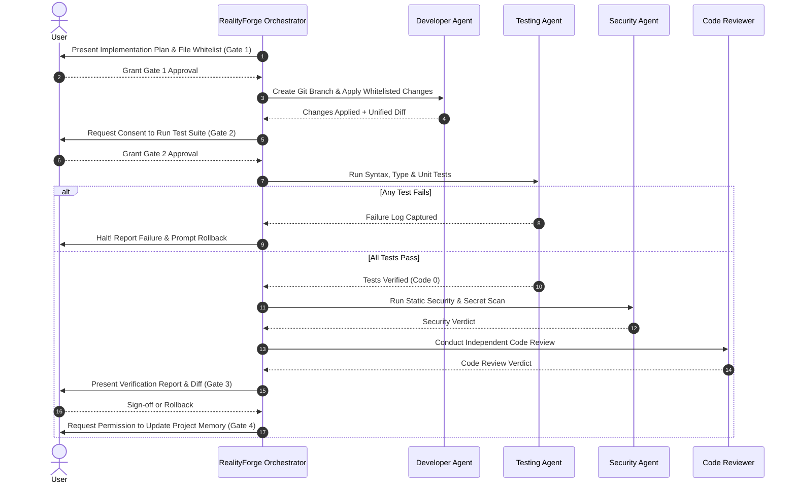

# Implementation Workflow (Engineering Mode)

This workflow applies approved source code changes under strict approval gates, automated testing, and guaranteed rollback mechanisms.

## Formal Workflow Steps

### Step 1: Pre-Implementation Approval (Gate 1)
* The `Decision Intelligence Agent` presents:
  - Exact list of files to be modified (File Whitelist).
  - Unified diff preview of intended changes.
  - Test strategy and pre-modification rollback command.
* **Hard Stop:** No source file is touched without explicit user confirmation.

### Step 2: Implementation (Developer Agent)
* Create isolated feature branch: `git checkout -b realityforge/<feature>-<timestamp>`.
* Apply edits strictly to whitelisted files.
* Scope lock: If an unapproved file modification is needed, **halt and request amended approval**.

### Step 3: Test Execution (Gate 2 & Testing Agent)
* Request user consent to run project test commands (Gate 2).
* Run Level 1 (syntax check: `node --check`, `python -m py_compile`).
* Run Level 2 (type check: `npx tsc --noEmit`).
* Run Level 4 (project test suite: `npm test`, `pytest`).
* **Halt Rule:** If any test fails, stop immediately, display failure output, and offer rollback.

### Step 4: Security Verification (Security Agent)
* Run static security checks on modified files.
* Confirm no secrets, credentials, or insecure patterns were introduced.

### Step 5: Code Review (Code Reviewer)
* Independently audit diff against original plan.
* Validate that no unapproved packages were added.
* Render review verdict: **APPROVED** or **CHANGES REQUIRED**.

### Step 6: Final Verification Sign-Off & Automatic PDF Generation (Gate 3)
* Aggregate findings into `templates/verification_report.md`.
* **Automatic PDF Generation:** Compile official A4 Engineering Notebook PDF via `reporting/pdf_generator.js` and store in `reports/RF-Report-<Project>-Verification-<Timestamp>.pdf`.
* Present diff, test evidence, and review verdict to the user.
* Await user sign-off. If rejected, trigger automated rollback.

### Step 7: Memory Persistence (Gate 4)
* Prompt user to persist approved changes into `memory/project_memory.json`.
* Only update memory upon explicit authorization.
